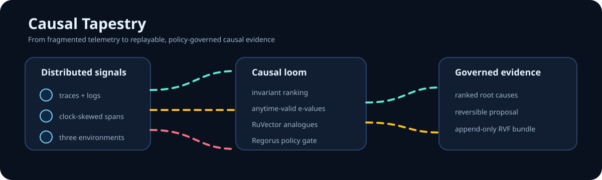
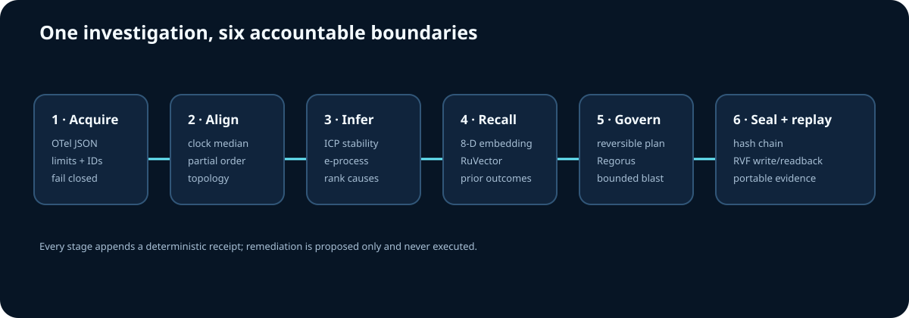

# Causal Tapestry



Causal Tapestry reconstructs a distributed incident from clock-skewed telemetry,
ranks causal root hypotheses across environments with anytime-valid evidence,
recalls analogous investigations through RuVector, gates a reversible remediation
proposal with Microsoft Regorus, and seals the full investigation as an append-only
RVF evidence bundle.

It is built for SREs, incident commanders, platform engineers, and reviewers who
need more than a plausible narrative: they need a deterministic path from raw
signals to a replayable and policy-governed decision record.

<p>
  
  
</p>

## What is new

No individual ingredient provides this combined capability. RuVector supplies
analogue retrieval, RVF supplies portable append-only storage, Regorus supplies
policy evaluation, and the causal layer tests stability across operational
environments while an e-process remains valid under continuous inspection.
Causal Tapestry joins those boundaries into one failure-aware investigation saga.



## Quickstart

Requirements: Rust 1.87 or newer.

```bash
cargo run --locked -p ct-cli -- \
  --incident-id inc-2026-10-21 \
  --input examples/cache-collapse.jsonl \
  --output evidence.rvf
```

The command prints a JSON report containing the ranked hypotheses, recalled
analogues, remediation proposal, policy decision, evidence root, and RVF path.
It never executes remediation.

Example excerpt:

```json
{
  "incident_id": "inc-2026-10-21",
  "event_count": 12,
  "proposal": {
    "action": "isolate_and_shift_traffic",
    "target_service": "cache",
    "reversible": true
  },
  "rvf_path": "evidence.rvf"
}
```

## Executed composition

| Ingredient | Pin | Executed responsibility | Test/ablation |
|---|---|---|---|
| RuVector core | `2.4.0`, source `46d816d` | In-memory exact analogue index and nearest-neighbour recall | `nearest_analogue_executes_ruvector`; `NoRuVector` |
| RVF runtime | `0.3.2`, source `46d816d` | Append-only bundle ingest, reopen, and query readback | `real_rvf_round_trip`; `NoRvf` |
| Microsoft Regorus | `0.13.0`, source `9d19b6a` | Rego evaluation of evidence, reversibility, and blast radius | allow/deny tests; `NoRegorus` |
| Invariant causal prediction | Peters et al. (2016) | Rank causes that remain explanatory across partitions | multi-environment end-to-end workload |
| Anytime-valid e-process | Ramdas et al.; Vovk & Wang | Accumulate nonnegative evidence under continuous review | invalid/supportive tests; `NoEProcess` |

Exact repositories, licenses, interfaces, tests, and ablations are in the
[integration matrix](docs/integration-matrix.md).

## Workspace map

The 22 crates are separate bounded responsibilities with typed caller edges:

| Layer | Crates |
|---|---|
| Contracts and runtime | `ct-types`, `ct-errors`, `ct-config` |
| Acquisition and reconstruction | `ct-otel`, `ct-ingest`, `ct-clock`, `ct-normalize`, `ct-timeline`, `ct-topology` |
| Causal intelligence | `ct-hypothesis`, `ct-evalue`, `ct-causal`, `ct-embedding` |
| Upstream composition | `ct-ruvector`, `ct-recall`, `ct-regorus`, `ct-rvf` |
| Governance and evidence | `ct-remediation`, `ct-policy`, `ct-evidence` |
| Application surfaces | `ct-orchestrator`, `ct-cli` |

The [architecture](docs/architecture.md) documents every crate's bounded context,
public API, callers, tests, ADR/DDD links, and acceptance criteria.

## Validation and evidence

Run the exact gates:

```bash
cargo fmt --all --check
cargo clippy --locked --workspace --all-targets --all-features -- -D warnings
cargo test --locked --workspace
cargo deny check
./scripts/run-benchmark.sh
```

The benchmark fixes its corpus, runs 25 iterations per mode, and reports combined,
RuVector-free, Regorus-free, e-process-free, and RVF-free executions. Current
candidate results are recorded in [benchmark evidence](docs/evidence/benchmark.md);
commands and raw receipts are in [validation evidence](docs/validation.md).

| Mode | Events | Mean (µs) | Analogues | Allowed | Top e-value | Capability loss |
|---|---:|---:|---:|---|---:|---|
| Combined | 600 | 4,387 | 2 | yes | 2.067250 | none |
| No RuVector | 600 | 4,287 | 0 | yes | 2.067250 | analogue recall |
| No Regorus | 600 | 4,008 | 2 | yes | 2.067250 | policy enforcement replaced by explicit unsafe baseline |
| No e-process | 600 | 4,389 | 2 | no | 1.000000 | anytime-valid evidence and authorization |
| No RVF | 600 | 2,581 | 2 | yes | 2.067250 | durable bundle and readback |

## Maturity and limitations

This is a research-grade incident decision-support system, not an autonomous
remediator. The deterministic eight-dimensional embedding is deliberately
inspectable and is not a semantic model. The causal test uses partitions as
environments and depends on adequate variation; sparse incidents can yield weak
e-values. Regorus policy is a governance boundary, not an authorization service.
RVF bundles are locally durable but are not remotely replicated by this project.
No production change is executed.

## Design record

- [Specification](docs/specification.md)
- [Architecture](docs/architecture.md)
- [Research](docs/research.md)
- [Implementation contract](docs/implementation-contract.md)
- [Traceability](docs/traceability.md)
- [25 ADRs](docs/adrs/README.md)
- [12 DDD documents](docs/ddd/README.md)
- [Core-memory guidance map](docs/core-memory-guidance-map.md)
- [Technology mark attribution](docs/assets/technology-marks.md)

## License

MIT OR Apache-2.0.

